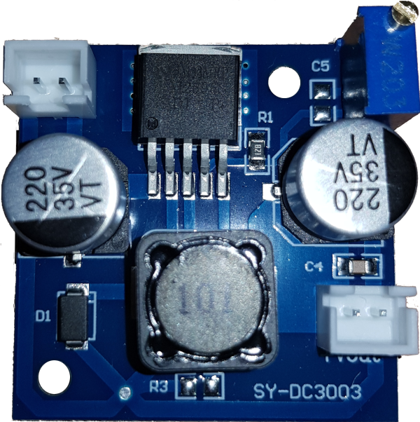
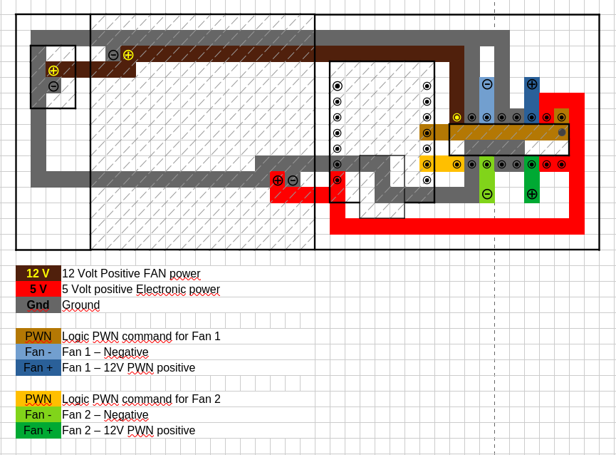
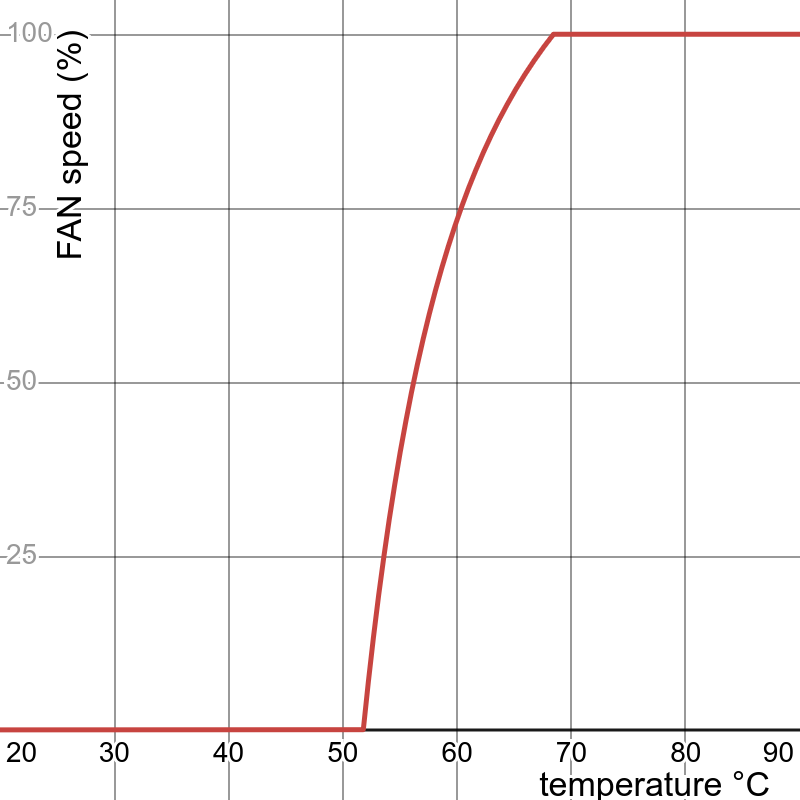
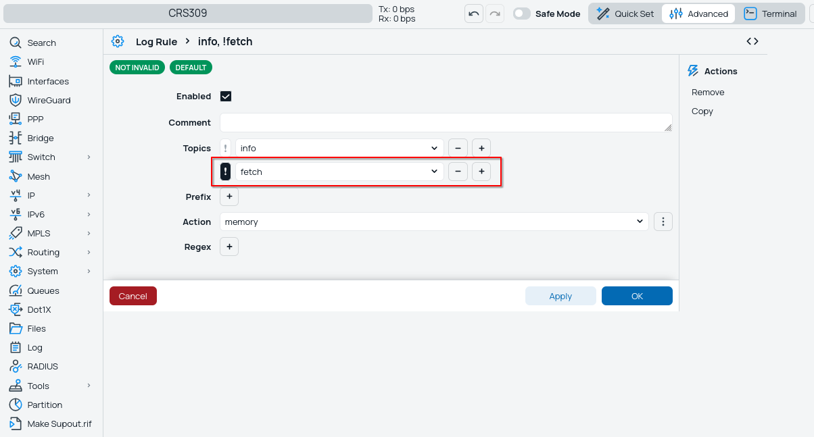
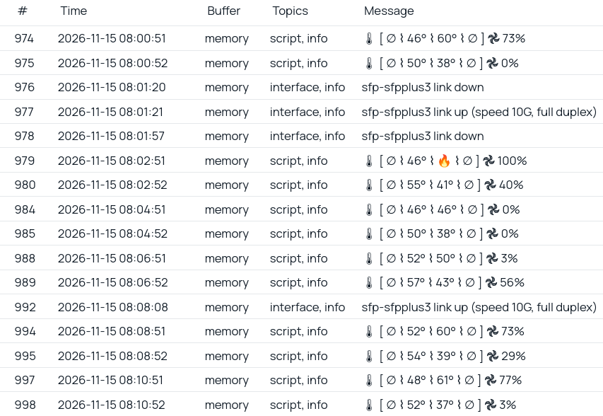

# CRS309-1G-8S+ Fan Mods
Hack to add fans to CRS309-1G-8S+

## Mikrotik CRS309-1G-8S+ and 10GB SFP+ RJ45
Mikrotik switch is a 10gb fanless switch, using RJ45 SFP+ coppers convertor (in Mikrotik S+RJ10) causes heating issues.
Mikrotik documented the issue and simply recommend to leave a space https://help.mikrotik.com/docs/spaces/ROS/pages/240156916/S+RJ10+general+guidance

### Symptoms
Tons of logs in router OS : 
```
sfp-sfpplus1 high temperature warning! Please, improve module cooling/placement or use different type of modules for this solution
```
Temperature visible in interface > Ethernet it is around 80°C in idle.
SFP+ disconnects regularly for fews minutes.

## The Hack
CRS-309 have enough some space for 20-15mmm thick FANs on top on SPF, the purpose is :
- Add two 60mm fans in front of SFP+
- Replace original power plug with a 12V model (CRS309 allows 12v - 57v DC input)
- Add an ESP32 and a L293D to pilot FAN speed in PWN
- Add a 12V to 5V DC-DC adapter to power ESP32
- Build a custom PCB
- Code esp32 software :
  - Set fans speed to 100%
  - Loop until WIFI is connected
  - Expose a HTTP REST web server :
     - Report fan speed via GET event
     - Handle FAN speed changes via POST event
 - Code Mikrotik script :
   - Read SFP temperature reported by ``` /interface/ethernet/monitor sfp-sfpplus<1-8> once proplist=sfp-temperature ```
   - Compute best FAN speed
   - Set corresponding fan speed with a HTTP request on esp32

## Hardware BOM
(you can find in Amazon or AliExpress too)
- FAN :
  - 2 x [SUN MF60151V3-1](https://www.reichelt.com/de/en/shop/product/axial_fan_60x60x15mm_12v_29_9m_h_21_3dba-260676) (Very noisy, you should buy something more expensive)
  - 2 x [DELOCK 67305](https://www.reichelt.com/de/en/shop/product/fan_grill_60_x_60_mm_silver-410074)
- PCB :
  - 1 x : [Perfboard](https://www.reichelt.com/de/en/shop/product/breadboard_laminated_paper_200x100_mm-8273) (100x40mm would be enough)
- Power :
  - 1 x [12V PSU](https://www.reichelt.com/de/en/shop/product/desktop_power_supply_42_w_12_v_3_5_a-215630)
  - 1 x [DC-DC volatge regulator](https://www.reichelt.com/de/en/shop/product/developer_boards_-_voltage_regulator_dc_dc_converter_lm2596-282578)
- Electronic :
  - 1 x [XIAO ESP32S3](https://www.reichelt.com/de/en/shop/product/xiao_esp32s3_dual-core_wifi_bt5_0_with_header-406872) (less powerful would been enough)
  - 1 x L293D (reused from an arduino kit) 

## Plan
### DC convertor 


DC to DC converter is a 4x4cm PCB
We will unsolder the two white Vin and Vout connectors and replace it by wires to main PCB.
One connector will be reused / solder to gridboard for 12V Vin..
### PCB


[tuto soudure](https://www.youtube.com/watch?v=_ypW45Y8VSs)

## Software

### Embedded
- Set GPIO output
- Set PWN frequencies
- Set FANs at 100%
- Setup Wifi and connect hardcoded wifi AP
- Once Wifi connected, Start embedded HTTP server
- 
#### HTTP server

##### GET /
Serve a default html help page

##### GET /api/fans
Returns HTTP Code 200, Content-Type:application/json
```json
[
  {
    "id": 0,     // FAN id [0, 1]
    "speed": 0   // Fan Speed [0..255]
  },
  {
    "id": 1,     // FAN id [0, 1]
    "speed": 255 // Fan Speed [0..255]
  }
]
```

##### GET /api/fans/$i 
Returns $i FAN data (HTTP Code 200, Content-Type:application/json)
```json
{
  "id": 0,     // FAN id [0, 1] 
  "speed": 255 // Current FAN speed [0..255]
}
```

##### GET /api/fans/$i/id 
Return FAN $i id (HTTP Code 200, Content-Type:application/json)
```json
1
```

##### GET /api/fans/$i/speed 
output [0..255]

##### PUT /api/fans/$i/speed
Compute and update fans speed and returns HTTP Code 204

##### GET /api/config :
```json
{
  "PWN_Frequency": 10000, //PWN frequency (default 10000Hz)
  "PWN_Resolution": 8     //PWN resolution (default 8bits)
}
 ```

##### GET /api/config/PWN_Frequency
Returns current PWN refresh rate (HTTP Code 200, Content-Type:application/json)
```json
10000
 ```

##### PUT /api/config/PWN_Frequency
Compute and update fans speed and returns HTTP Code 204

##### GET /api/config/PWN_Resolution
```json
8
 ```

##### PUT /api/config/PWN_Resolution
Compute and update fans speed and returns HTTP Code 204
 
### Mikrotik Router OS 
a schedule script get temperature of the warmer SFP, then compute the corresponding fan speed.


$speed(temp) = \frac{a}{ ( b \times temp )^2 } + \frac{c \times temp}{ 100 } + d$

with
- $a=-80000$
- $b=36$
- $c=60$
- $d=290$

[Live demo ](https://www.desmos.com/calculator/eqlqw0083e)
#### Schedule a task
Software will be done as a Mikrotik scheduled script, which will code this algorithm :
- Set a local variable max_temp to 0°
- Read sfp-1 to sfp-4 state :
  - No SFP found, continue
  - a SFP module is present, read temperature :
    - SFP Temperature attribute is missing (S-RJ10+ overheat and is stuck in a reboot loop)
      - Set max_temp = 999
      - Set all FAN to 100%
      - Ring beeper alarm
    - SFP Temperature is higher than max_temp
      - Set max_temp = SFP Temperature
- Compute optimal FAN speed for max_temp
- Set fan speed with fetch tool ``` /tool/fetch url="http://192.168.xxx.yyy/api/fans/0/speed" http-method=put http-header-field="Content-Type:text/plain" http-data=255 output=none; ```
- Repeat for sfp-5 to sfp-8 and second fan
  
Go to /system/scheduler
add a schedule every 2min :
```bash
{
  :local ip "192.168.150.46";
  :global overheat false;

  # Usage $fan first_sfp_id last_sfp_id esp32_address fan_id
  # Get max temperature of the givens SFP, then compute fan speed [0..255] 
  #                            a          c.max_temp
  # fan_speed(max_temp) = ------------- + ---------- + d
  #                       (b.max_temp)²       100
  :local fan do={
    # Adjust a,b,c,d : https://www.desmos.com/calculator/eqlqw0083e
    :local a -80000;
    :local b 36;
    :local c 60;
    :local d 290;
    # Get warmer SFP temperature
    :local maxtemp 0;
    :local detail "";
    :for idx from=$1 to=$2 do={
      :if ($detail != "") do={ :set detail ($detail . " ⌇ "); };
      :if ( ([/interface/ethernet/monitor $idx as-value once]->"sfp-module-present") ) do={
        :if ( [/interface/get ( "sfp-sfpplus" . $idx ) running] ) do={
          :if ( ([/interface/ethernet/monitor $idx as-value once]->"sfp-temperature") ) do={
            :local temp ([/interface/ethernet/monitor $idx as-value once]->"sfp-temperature");
            :set detail ( $detail . $temp . "°" );
            :if ( $maxtemp < $temp ) do={
              :set maxtemp $temp;
            };
          } else={
            :set detail ( $detail . "🔥" );
            :set maxtemp 999;
            :global overheat;
            :set overheat true;
          };
        } else={
            :set detail ( $detail . "🔥" );
            :set maxtemp 999;
            :global overheat;
            :set overheat true;
          };
      } else={ 
        :set detail ( $detail . "∅" );
      };
    };
    # Compute FAN speed
    :local fanspeed ( ( $a / ( ( $maxtemp - $b ) * ( $maxtemp - $b ) ) ) + ( $c * $maxtemp / 100 ) + $d );
    :if ( fanspeed < 0 ) do={ :set fanspeed 0; }
    :if ( fanspeed > 255 ) do={ :set fanspeed 255; }
    /tool/fetch url="http://$3/api/fans/$4/speed" http-method=put http-header-field="Content-Type:text/plain" http-data=$fanspeed output=none;
    :log info ( "🌡 [ " . $detail . " ] 𖣘 " . ( $fanspeed * 100 / 255 ) . "%" );
  };
  # sfp-1 to sfp-4 => fan #1
  $fan 1 4 $ip 1;
  # sfp-5 to sfp-8 => fan #0
  $fan 5 8 $ip 0;
  # In case of overheating, set all to 100%
  :if ($overheat) do={
    :log error ( "🚒 SFP overheat force fans full speed");
    /tool/fetch url="http://$ip/api/fans/0/speed" http-method=put http-header-field="Content-Type:text/plain" http-data=255 output=none;
    /tool/fetch url="http://$ip/api/fans/1/speed" http-method=put http-header-field="Content-Type:text/plain" http-data=255 output=none;
    :for c from=1 to=5 step=1  do={
      for i from=700 to=3600 step=25 do={:beep length=10ms frequency=$i; :delay 10ms;}
      delay 800ms; 
    }
  }
}
```
#### Log setting
/tool/fetch logs an entry in memory log each time it's called, so two entries each minute !), to avoid log spam you can disable it in /system/logging, by adding a "! fetch" on topics info :



#### Example of logs
Overheating still occurs, here is an example :

- 8:00 sfp-3 was running normally at 60° and its corresponding fans at 73%
- 8:01 disconnection occurs
- 8:02 script detect overheating, set fans at 100%, and ring the alarm
- 8:08 sfp-3 came up again

## Limitations / TODO list
- Take photo of finished PCB :D
- [TUNE] Fans are a bit noisy, maybe I need to code a better PWN algorithm
- [ENHANCEMENT] Find a better fans algorithm taking into account the neighbor fan : sometimes one fans runs at 100% while next one is off, this is not optimal.
- [ENHANCEMENT] Check if esp32 code can be move to esphome instead of arduino, implement OTA update
