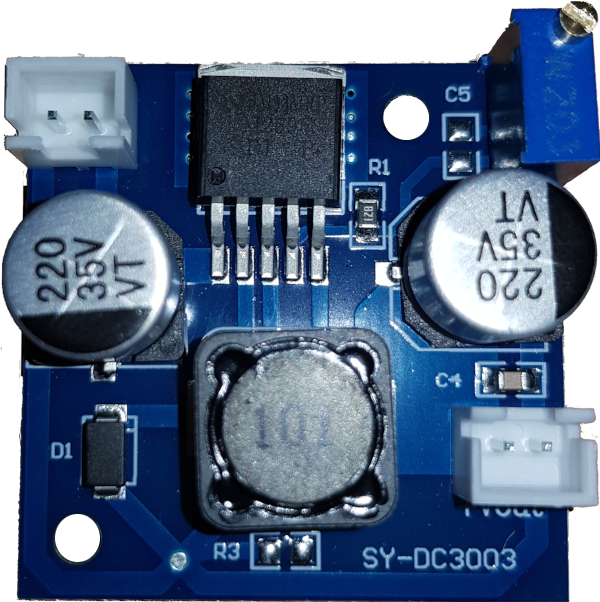
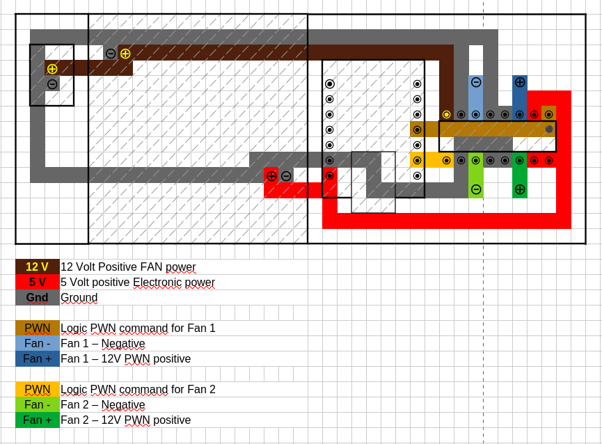
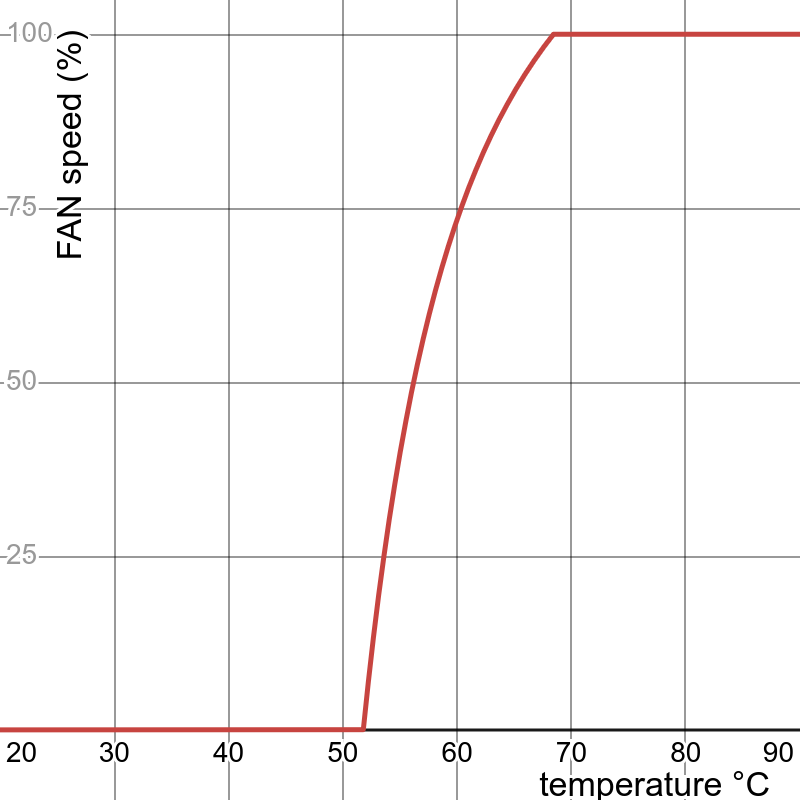

# CRS309-1G-8S+ Fan Mods
Hack to add fans to CRS309-1G-8S+

## Mikrotik CRS309-1G-8S+ and 10GB SFP+ RJ45
Mikrotik switch is a 10gb fanless switch, using RJ45 SFP+ coppers convertor (in Mikrotik S+RJ10) causes heating issues.
Mikrotik documented the issue and simply recommend to leave a space https://help.mikrotik.com/docs/spaces/ROS/pages/240156916/S+RJ10+general+guidance

### Symptoms
Tons of logs in router OS : 
```
sfp-sfpplus1 high temperature warning! Please, improve module cooling/placement or use different type of modules for this solution
```
Temperature visible in interface > Ethernet is around 80°C in idle.
SFP+ disconnects regulary for fews minutes

## The Hack
CRS-309 have enough some space for 20-15mmm thick FANs on top on SPF, the purpose is :
- Add 2 x 60mm fans in front of SFP+
- Replace original power plug with a 12V model (CRS309 allows 12v - 57v DC input)
- Add an ESP32 and a L293D to pilot FAN speed in PWN
- Add a 12V to 5V DC-DC adapter to power ESP32
- Build a custom PCB
- Code software :
  - Set fans speed to 100%
  - Loop until WIFI is connected
  - Expose a HTTP REST web server :
     - Report fan speed via GET event
     - Handle FAN speed changes via POST event

## Hardware BOM
(you can find in Amazon or AliExpress too)
- FAN :
  - 2 x [SUN MF60151V3-1](https://www.reichelt.com/de/en/shop/product/axial_fan_60x60x15mm_12v_29_9m_h_21_3dba-260676) (Very noisy, you should buy something more expensive)
  - 2 x [DELOCK 67305](https://www.reichelt.com/de/en/shop/product/fan_grill_60_x_60_mm_silver-410074)
- PCB :
  - 1 x : [Perfboard](https://www.reichelt.com/de/en/shop/product/breadboard_laminated_paper_200x100_mm-8273) (100x40mm would be enough)
- Power :
  - 1 x [12V PSU](https://www.reichelt.com/de/en/shop/product/desktop_power_supply_42_w_12_v_3_5_a-215630)
  - 1 x [DC-DC volatge regulator](https://www.reichelt.com/de/en/shop/product/developer_boards_-_voltage_regulator_dc_dc_converter_lm2596-282578)
- Electronic :
  - 1 x [XIAO ESP32S3](https://www.reichelt.com/de/en/shop/product/xiao_esp32s3_dual-core_wifi_bt5_0_with_header-406872) (less powerful would been enough)
  - 1 x L293D (reused from an arduino kit) 

## Plan
### DC convertor 


DC to DC converter is a 4x4cm PCB
We will unsolder the two white Vin and Vout connectors and replace it by wires to main PCB.
One connector will be reused / solder to gridboard for 12V Vin..
### PCB


[tuto soudure](https://www.youtube.com/watch?v=_ypW45Y8VSs)

## Software

### Embedded
- Set GPIO output
- Set PWN frequencies
- Set FANs at 100%
- Setup Wifi and connect hardcoded wifi AP
- Once Wifi connected, Start embedded HTTP server
- 
#### HTTP server

##### GET /
Serve a default html help page

##### GET /api/fans
Returns HTTP Code 200, Content-Type:application/json
```json
[
  {
    "id": 0,     // FAN id [0, 1]
    "speed": 0   // Fan Speed [0..255]
  },
  {
    "id": 1,     // FAN id [0, 1]
    "speed": 255 // Fan Speed [0..255]
  }
]
```

##### GET /api/fans/$i 
Returns $i FAN data (HTTP Code 200, Content-Type:application/json)
```json
{
  "id": 0,     // FAN id [0, 1] 
  "speed": 255 // Current FAN speed [0..255]
}
```

##### GET /api/fans/$i/id 
Return FAN $i id (HTTP Code 200, Content-Type:application/json)
```json
1
```

##### GET /api/fans/$i/speed 
output [0..255]

##### PUT /api/fans/$i/speed
Compute and update fans speed and returns HTTP Code 204

##### GET /api/config :
```json
{
  "PWN_Frequency": 10000, //PWN frequency (default 10000Hz)
  "PWN_Resolution": 8     //PWN resolution (default 8bits)
}
 ```

##### GET /api/config/PWN_Frequency
Returns current PWN refresh rate (HTTP Code 200, Content-Type:application/json)
```json
10000
 ```

##### PUT /api/config/PWN_Frequency
Compute and update fans speed and returns HTTP Code 204

##### GET /api/config/PWN_Resolution
```json
8
 ```

##### PUT /api/config/PWN_Resolution
Compute and update fans speed and returns HTTP Code 204
 
### Mikrotik Router OS 
a schedule script get temperature of the warmer SFP, then compute fan speed

- $a=-80000$
- $b=36$
- $c=60$
- $d=290$

$speed(temp) = \frac{a}{ ( b \times temp )^2 } + \frac{c \times temp}{ 100 } + d$




[Live demo ](https://www.desmos.com/calculator/eqlqw0083e)

Go to /system/schedule
add a schedule every 2min :
```bash
{
  # Usage $fan first_sfp_id last_sfp_id esp32_address fan_id
  # Get max temperature of the givens SFP, then compute fan speed [0..255] 
  #                            a          c.max_temp
  # fan_speed(max_temp) = ------------- + ---------- + d
  #                       (b.max_temp)²       100
  :local fan do={
    # Adjust a,b,c,d : https://www.desmos.com/calculator/eqlqw0083e
    :local a -80000;
    :local b 36;
    :local c 60;
    :local d 290;
    # Get warmer SFP temperature
    :local maxtemp 0;
    :for idx from=$1 to=$2 do={
      :if ( $maxtemp < ([/interface/ethernet/monitor $idx as-value once]->"sfp-temperature") ) do={
        :set maxtemp ([/interface/ethernet/monitor 3 as-value once]->"sfp-temperature");
      };
    };
    # Compute FAN speed
    :local fanspeed ( ( $a / ( ( $maxtemp - $b ) * ( $maxtemp - $b ) ) ) + ( $c * $maxtemp / 100 ) + $d );
    :if ( fanspeed < 0 ) do={ :set fanspeed 0; }
    :if ( fanspeed > 255 ) do={ :set fanspeed 255; }
      /tool/fetch url="http://$3/api/fans/$4/speed" http-method=put http-header-field="Content-Type:text/plain" http-data=$fanspeed output=none;
    };
    
    # sfp-1 to sfp-4 => fan #0
    $fan 1 4 "192.168.150.46" 0;
    # sfp-5 to sfp-8 => fan #1
    $fan 5 8 "192.168.150.46" 1;
}
```
